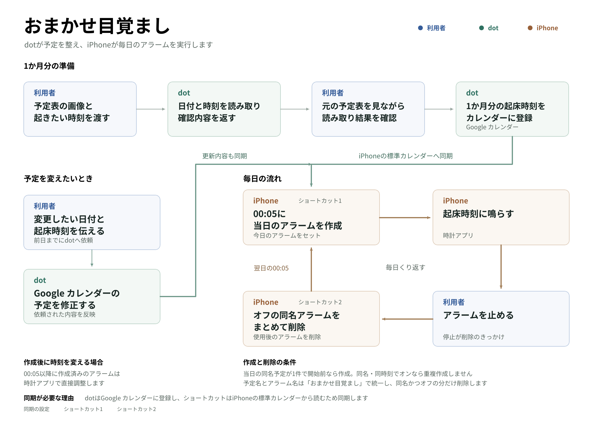

# おまかせ目覚まし

[PDFで見る](alarm-workflow.pdf)

予定表と起きたい時刻をdotに渡すと、内容をカレンダーに登録します。iPhoneはその予定をもとに毎日のアラームを自動でセットし、止めた後に自動で削除します。

## 作ったきっかけ

24時間365日動くエージェントなら、生活の一部を任せられるかもしれない。それなら日々の繰り返しで、手間に感じることは何だろうと考えました。

そこで思い浮かんだのが、毎日のアラームをセットする作業でした。私の場合は「時計アプリを開き」「用意しておいた」何パターンかの時刻から予定に合うものを「考えて」「選んで」いました。設定を「忘れる」こともありました。

当たり前のように繰り返していたけれど、この作業をdotに任せられないだろうか？予定に合わせてアラームが自動でセットされ、使い終われば片付けまで済んでいる。そんな仕組みにしたくて「おまかせ目覚まし」を作りました。

## 必要なもの

- iPhone
- iPhone純正の「カレンダー」「時計」「ショートカット」アプリ
- Googleアカウント
- Googleカレンダー
- dot側のGoogleカレンダー連携

ショートカットはiPhone純正カレンダーに対応  
ChatGPTはGoogleカレンダーに対応  
GoogleカレンダーからiPhone純正カレンダーに同期させるために2種類必要です。

## 導入

1. 次の2つをiPhoneへ追加します。オートメーションがオンになっていることを確認してください。
   - [今日のアラームをセット](https://www.icloud.com/shortcuts/615bc3984e124adf847b72e0f7000ea9)
   - [使用後のアラームを削除](https://www.icloud.com/shortcuts/1be490b4f10343d789a37be09e1a7615)
2. dot側でGoogleカレンダーを連携し、同じアカウントをiPhoneの設定に追加してカレンダー同期をONにします。iPhone純正カレンダーに予定が表示されるか確認してください。[同期手順](https://support.google.com/calendar/answer/99358?co=GENIE.Platform%3DiOS&hl=ja)
3. 予定表と起きたい時刻をdotに渡します。dotが正しく日付と時刻を読み取り、予定表と合うか確認してから、「おまかせ目覚まし」というタイトルでカレンダーに登録してもらいます。もし予定が変わったら、前日までにdotへ伝えて調整してもらいましょう。

## 注意

- **使い始める前に、アラームが作成されて鳴ることをdotと確認してください**
- 00:00〜00:05の起床には対応していません。
