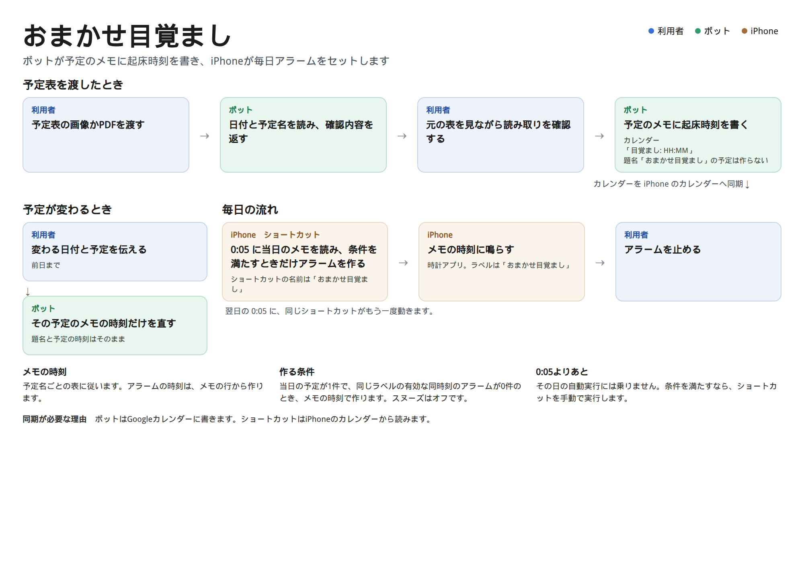

# おまかせ目覚まし

[PDFで見る](docs/alarm-workflow.pdf)

予定表をボットに渡すと、カレンダーの予定のメモ欄に「目覚まし: HH:MM」と書きます。アラームの名前が「おまかせ目覚まし」です。iPhoneのショートカット「おまかせ目覚まし」が毎日 0:05 にそのメモを読み、アラームをセットします。

## 作ったきっかけ

24時間365日動くエージェントなら、生活の一部を任せられるかもしれない。それなら日々の繰り返しで、手間に感じることは何だろうと考えました。

そこで思い浮かんだのが、毎日のアラームをセットする作業でした。私の場合は「時計アプリを開き」「用意しておいた」何パターンかの時刻から予定に合うものを「考えて」「選んで」いました。設定を「忘れる」こともありました。

当たり前のように繰り返していたけれど、この作業をボットに任せられないだろうか？予定が決まれば起床時刻も決まり、アラームが自動でセットされています。そんな仕組みにしたくて「おまかせ目覚まし」を作りました。

## 必要なもの

- iPhone
- iPhone純正の「カレンダー」「時計」「ショートカット」アプリ
- Googleアカウント
- Googleカレンダー
- ボット側のGoogleカレンダー連携
- ショートカット（追加用）：[おまかせ目覚まし](https://www.icloud.com/shortcuts/a774e0492db1434ab055832e32e105a3)
- ショートカット（掃除用）：[使用後のアラームを削除](https://www.icloud.com/shortcuts/1be490b4f10343d789a37be09e1a7615)

ボットはGoogleカレンダーにメモを書きます。ショートカットはiPhoneのカレンダーに同期された同じ予定のメモを読みます。

## 起床時刻

書く時刻は予定名ごとの表だけを使います。どの予定も表の開始時刻の1時間前です。

時刻は日本時間です。メモの行は「目覚まし: 05:45」の形です。コロンのうしろに空白を置き、時は2桁にします。予定の題名は表の予定名のままです。予定のない日は、この行を書きません。00:00〜00:05 の起床になるときは行を書かず、本人に聞きます。表にない予定名からは時刻を決めません。

## 導入

1. GoogleアカウントをiPhoneの設定に追加し、カレンダーの同期をオンにします。カレンダーAppに、そのアカウントの予定が表示されることを確認します。[同期手順](https://support.google.com/calendar/answer/99358?co=GENIE.Platform%3DiOS&hl=ja)
2. ショートカットAppに追加します。名前は「おまかせ目覚まし」です。毎日 0:05（Asia/Tokyo）に動くオートメーションが付いています。
3. 予定表をボットに渡します。日付と予定名が表と合うことを確かめてから、各予定のメモ欄に起床時刻を書いてもらいます。予定が変わったら、前日までにボットへ伝えます。

## ショートカットの手順

追加したショートカットのアクションは、次の順です。

1. カレンダーイベントを検索します。開始日は今日、メモは「目覚まし:」を含みます。
2. 検索結果の数を数えます。
3. 数が1に等しいときだけ、手順4から手順21まで進みます。
4. 検索結果から最初の1件を取り出します。
5. その予定のメモを取り出します。
6. メモを大文字と小文字を区別する正規表現 `目覚まし: (\d{1,2}):(\d{2})` に当てます。
7. 一致したテキストから、グループのインデックス1を取り出します。
8. 取り出した文字列を、変数「インデックス 1」に入れます。1の前に空白が1つあります。
9. 一致したテキストから、グループのインデックス2を取り出します。
10. 取り出した文字列を、変数「インデックス2」に入れます。この名前に空白はありません。
11. 計算で、0に変数「インデックス 1」を足します。
12. 計算で、0に変数「インデックス2」を足します。
13. アラームを検索します。ラベルは「おまかせ目覚まし」、有効である、時は手順11の計算結果、分は手順12の計算結果です。
14. 検索したアラームの数を数えます。
15. 数が0に等しいときだけ、手順16から手順19まで進みます。
16. テキストを作ります。手順7の文字列、コロン、手順9の文字列の順です。コロンの前後に空白は置きません。
17. そのテキストから日付を検出します。
18. 検出した日付の最初の1件を取り出します。
19. アラームを作成します。名前は「おまかせ目覚まし」、時刻は手順18の日付、スヌーズはオフです。
20. 手順15の条件を終わります。
21. 手順3の条件を終わります。

## メモの書き方

1. カレンダーの予定のうち、題名が予定名ごとの表にあるものだけを見ます。
2. 同じ日の対象が2件以上なら、メモを書かずに本人へ知らせます。
3. 既にある説明は残します。「目覚まし: HH:MM」の行がなければ改行して足し、あればその行の時刻だけを表に合わせます。同じ行が重なっていれば1行にします。
4. 題名、開始、終了、色は変えません。更新通知は送りません（sendUpdates は none）。
5. 書き戻した予定を読み、行の時刻が表と合い、行が1つであることを確かめます。

## 注意

- 使い始める前に、アラームが作られて、その時刻に鳴ることを端末で確認してください。
- 0:05 よりあとにメモを足したり直したりしても、その日の自動実行には入りません。当日の検索が1件で、同じラベルかつ有効かつ同じ時分のアラームが無いときは、ショートカットを手動で実行します。
